<div align="center">

# agent-verse

### A multi-agent playground built with **Agno** — free-tier **Groq** + **Gemini** models, live web and finance tools, persistent memory, and a Streamlit YouTube analyzer (**TubeLens**).


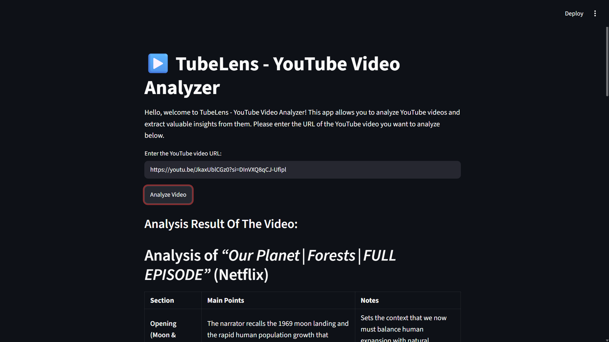

</div>

---

## Table of Contents

- [Demo / Screenshots](#demo--screenshots)
- [Problem Statement](#problem-statement)
- [Solution Overview](#solution-overview)
- [Key Features](#key-features)
- [Architecture](#architecture)
- [Technology Stack](#technology-stack--complete-breakdown)
- [Request Lifecycle](#request-lifecycle)
- [Data Flow](#data-flow)
- [UML Diagrams](#uml-diagrams)
- [Data Flow Diagrams](#data-flow-diagrams)
- [Folder Structure](#folder-structure)
- [Getting Started](#getting-started)
- [Configuration](#configuration)
- [Security Considerations](#security-considerations)
- [Error Handling, Logging and Testing](#error-handling-logging-and-testing)
- [Engineering Decisions and Tradeoffs](#engineering-decisions-and-tradeoffs)
- [Known Limitations](#known-limitations)
- [Troubleshooting Guide](#troubleshooting-guide)
- [FAQ](#faq)

---

## Demo / Screenshots

> All screenshots below are real runs of this repository on my machine (Windows, VS Code terminal, Streamlit on `localhost:8501`).

### TubeLens — YouTube Video Analyzer (`ui.py`)

| Landing page and first analysis | Structured analysis table |
|---|---|
|  | 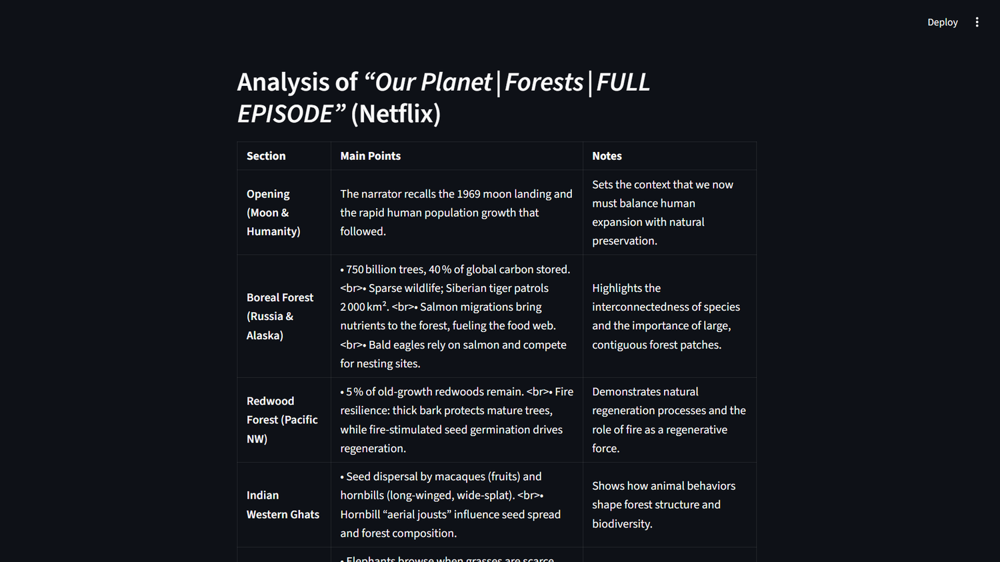 |

| Video overview with metadata and sources | Key insights table |
|---|---|
| 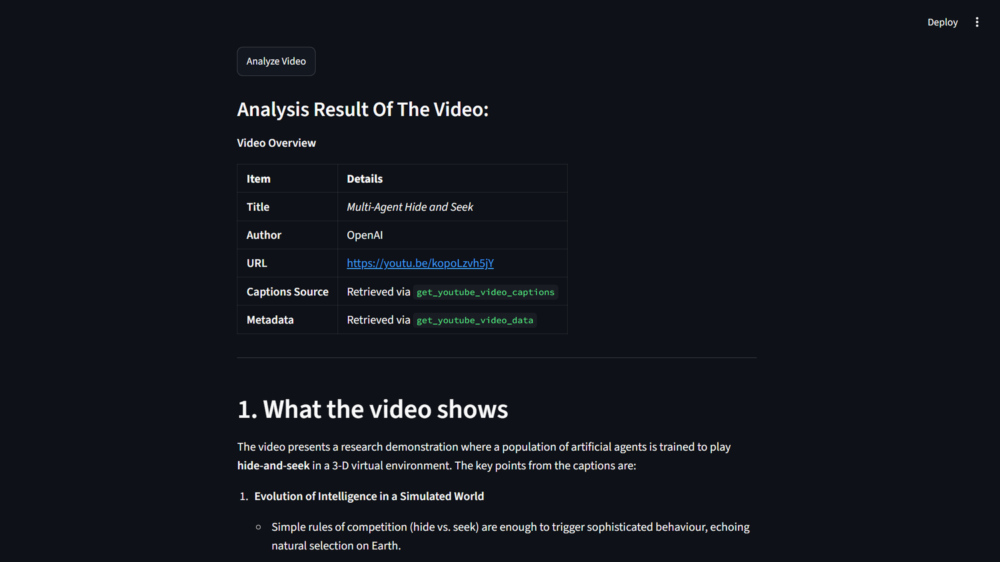 | 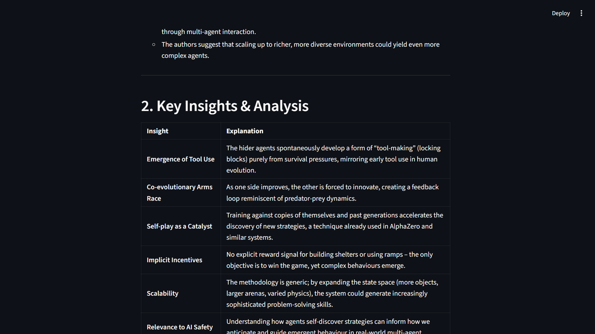 |

### Travel Agent (`agent.py`)

The agent decides on its own to call `web_search` and `search_news` before answering.

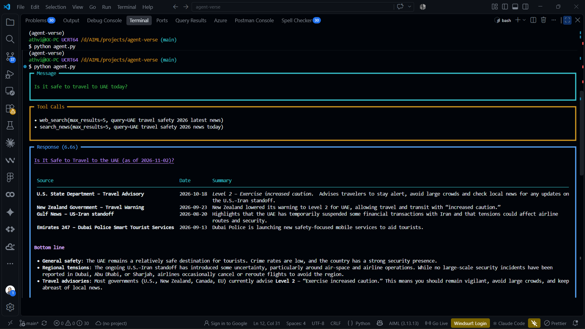

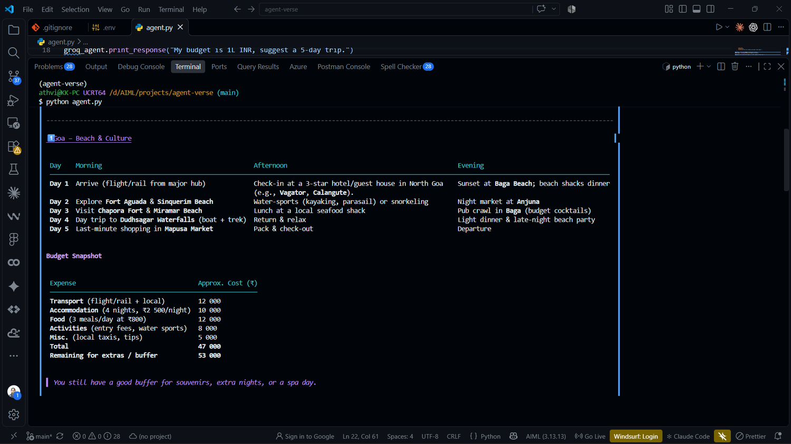

### Finance Agent (`finance_agent.py`)

| Analyst consensus table | USD to INR conversion with sources |
|---|---|
| 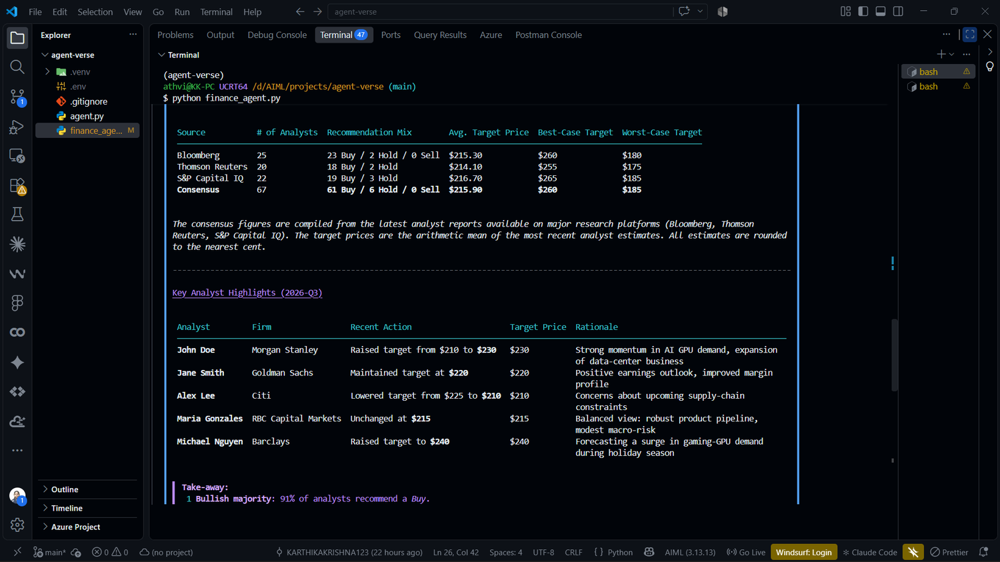 | 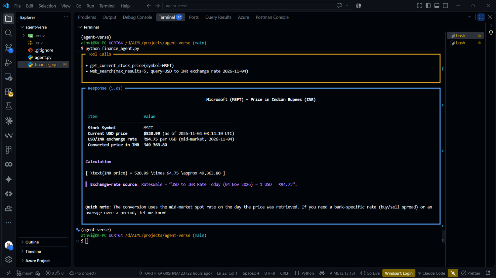 |

### Language Team (`team.py`)

One question is delegated to three member agents (English, Chinese, Hindi) and the answers are combined.

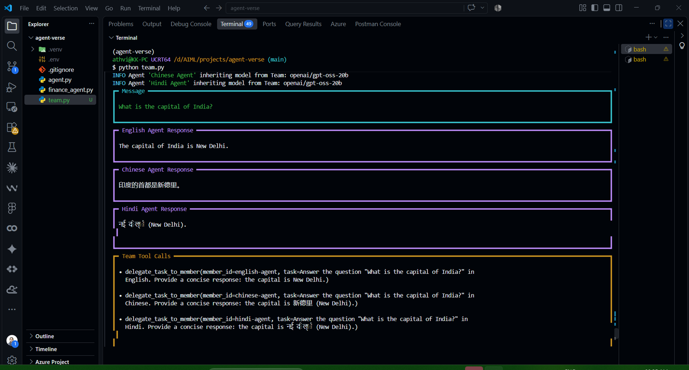

### Agent with Memory (`memory.py`)

| Cross-turn recall and stored `UserMemory` rows | Session history follow-up |
|---|---|
| 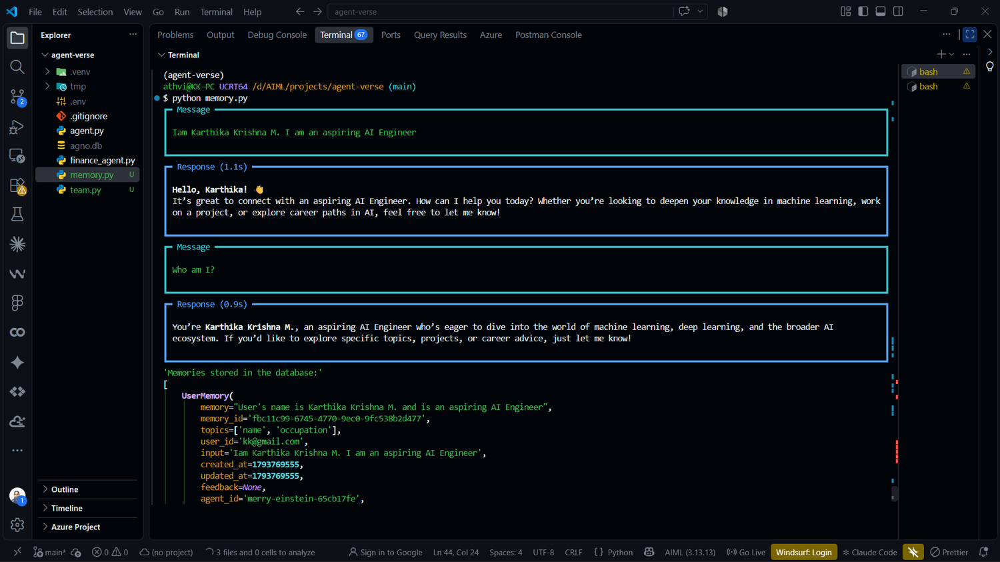 | 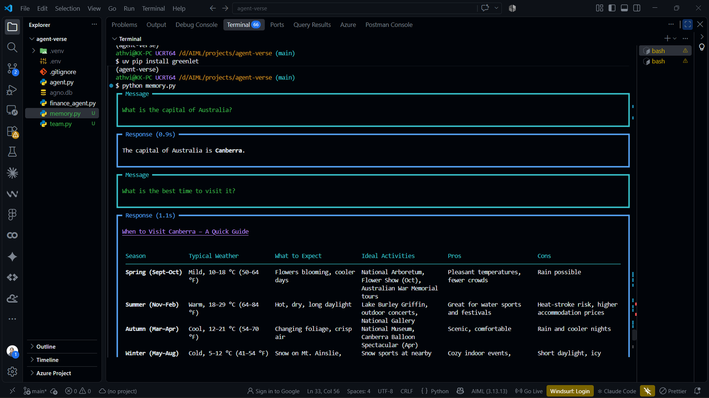 |

### YouTube analyzer from the CLI (`youtube_analyzer.py`)

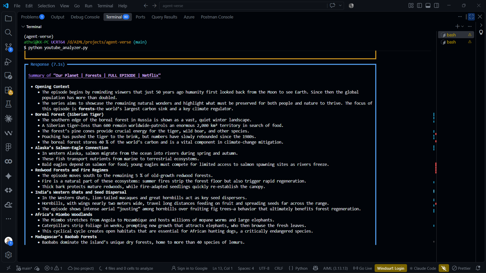

---

## Problem Statement

Learning agentic AI from tutorials usually means copying code that targets paid OpenAI models. That is a barrier for students: free-tier quotas, retired model IDs and unfamiliar framework APIs break copied code in ways that are hard to debug.

## Solution Overview

**agent-verse** re-implements the "Agentic AI with Agno" tutorial series on **free** model providers (Groq and Google Gemini) and documents every real error hit along the way. Each file is a small, runnable experiment that isolates one agentic concept:

| File | Concept demonstrated |
|---|---|
| `agent.py` | A single tool-using agent (web search) running on two interchangeable LLM providers |
| `finance_agent.py` | Multiple tools (market data and web search) with a role-specific prompt |
| `team.py` | A coordinating **Team** that delegates one question to several specialist agents |
| `memory.py` | Persistent user memory and session history in SQLite |
| `youtube_analyzer.py` | An agent with the YouTube transcript tool, packaged as a reusable factory |
| `ui.py` | **TubeLens**, a Streamlit front end around the YouTube agent |

## Key Features

| Feature | Description | Where |
|---|---|---|
| Provider-agnostic agents | `build_agent(model)` factory builds the same agent on Groq or Gemini | `agent.py`, `finance_agent.py` |
| Live web search | DuckDuckGo search and news tools the model calls on demand | `agent.py`, `finance_agent.py` |
| Market data | Stock price and analyst recommendations via `YFinanceTools` | `finance_agent.py` |
| Multi-agent team | Delegation to English, Chinese and Hindi members, all answers returned | `team.py` |
| Persistent memory | `SqliteDb` stores user memories and chat history across runs | `memory.py` |
| Video analysis | Transcript retrieval with language fallbacks (`en`, `en-US`, `en-GB`) | `youtube_analyzer.py` |
| Web UI | Streamlit app with cached agent and one-click analysis | `ui.py` |
| Secret hygiene | API keys read from `.env`, which is git-ignored | `.gitignore` |

---

## Architecture

### Overall Architecture

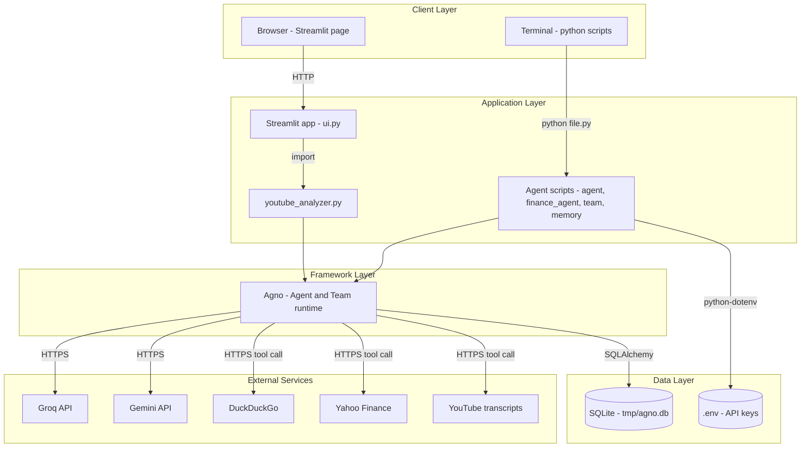

### System Architecture (modules)

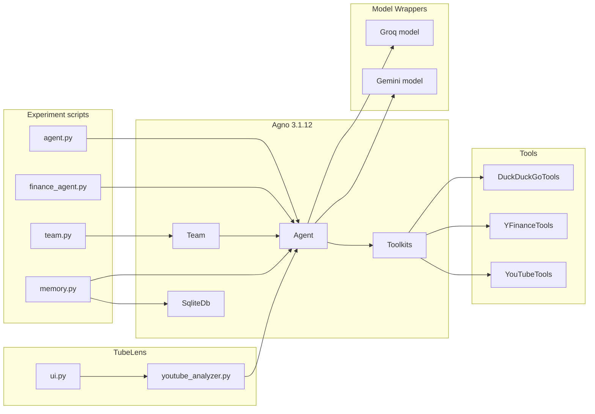

---

## Technology Stack — Complete Breakdown

> Every dependency pinned in `requirements.txt`, with how it is actually used in this repo. `uv` is the environment tool (not pinned in the manifest).

| Technology / Package | Version | Category | Purpose in Project | Why Chosen | Key Features Used |
|---|---|---|---|---|---|
| Python | 3.12 (venv created with uv) | Language | Runtime for every script and the Streamlit app | Required by the Agno ecosystem; rich AI library support | f-strings, modules, `if __name__ == "__main__"` guards |
| agno | 3.1.12 | Agent Framework | Builds `Agent` and `Team` objects, runs tool-calling loops, stores memory | Small API surface, built-in tools, memory and team delegation | `Agent`, `Team`, `SqliteDb`, `DuckDuckGoTools`, `YFinanceTools`, `YouTubeTools`, `print_response`, `run().content` |
| groq | 1.7.0 | LLM SDK | Client behind `agno.models.groq.Groq` | Free tier with fast inference | `openai/gpt-oss-20b` chat completions with tool calling |
| google-genai | 2.34.0 | LLM SDK | Client behind `agno.models.google.Gemini` | Free API key, strong Flash models | `gemini-3.8-flash` generation with tool calling |
| ddgs | 9.16.1 | Search Tool Backend | Backend for `DuckDuckGoTools` (`web_search`, `search_news`) | Key-free web search | Text and news search, `max_results` |
| yfinance | 1.7.0 | Market Data | Backend for `YFinanceTools` | Free Yahoo Finance access | `get_current_stock_price`, analyst recommendations |
| youtube-transcript-api | 1.2.4 | Transcript Tool Backend | Backend for `YouTubeTools` captions | No API key needed | Caption listing, language-code selection |
| streamlit | 1.66.1 | Web UI | TubeLens front end | Python-only UI in a few lines | `st.text_input`, `st.button`, `st.markdown`, `@st.cache_resource` |
| python-dotenv | 1.2.4 | Configuration | Loads `GROQ_API_KEY` and `GOOGLE_API_KEY` from `.env` | 12-factor style secrets handling | `load_dotenv()` |
| sqlalchemy | 2.1.8 | Database Toolkit | Required by Agno's `SqliteDb` | Standard Python SQL layer | Engine and session management (via Agno) |
| greenlet | 3.5.6 | Runtime Dependency | Needed by SQLAlchemy's async machinery used by `SqliteDb` | Fixed a real `ImportError` during setup | Imported transitively |
| rich | 15.0.0 | Terminal Output | Panels and tables printed by `print_response` and memory dumps | Readable agent traces | `pprint`, boxed panels |
| SQLite | bundled | Database | `tmp/agno.db` for memories and sessions | Zero-setup file database | `user_memory` rows, session history |
| uv | — | Package and Env Manager | Creates `.venv` and installs requirements | Much faster than plain pip | `uv venv`, `uv pip install -r` |
| Git and GitHub | — | Version Control | Source hosting; tracked as a submodule of the parent AIML repo | Standard workflow | `.gitignore`, submodule |

---

## Request Lifecycle

### Flow 1 — TubeLens: "Analyze Video" (a read-style request that calls tools)

```
1. USER INTERACTION
   └── User pastes a YouTube URL into st.text_input and clicks "Analyze Video"
       → File: ui.py

2. STREAMLIT RERUN
   └── Streamlit re-executes ui.py top to bottom
       → get_agent() is wrapped in @st.cache_resource, so the Agent is built once
       → get_agent() calls build_youtube_agent() in youtube_analyzer.py

3. AGENT RUN
   └── ui.py calls agent.run(f"Analyze this video: {video_url}")
       → Agno sends instructions + user message to Groq (openai/gpt-oss-20b)

4. MODEL DECIDES TO USE TOOLS
   └── Instructions say "use the tools before answering"
       → Model emits tool calls: get_youtube_video_data(url) and get_youtube_video_captions(url)
       → YouTubeTools(languages=["en", "en-US", "en-GB"]) fetches captions via youtube-transcript-api

5. TOOL RESULT RETURNS
   └── Success: caption text (without timestamps) goes back into the model context
   └── Failure: the tool returns an error string instead of raising
       (for example "No transcripts were found for the requested language codes")

6. FINAL ANSWER
   └── Groq returns markdown (tables, key themes, takeaways)
       → agent.run(...) returns a RunOutput; ui.py renders response.content with st.markdown

7. ERROR PATH
   └── If captions are unavailable the model is told to say so and use only title/author metadata
       → The README screenshot ts-01 shows this honest "captions unavailable" output
```

### Flow 2 — Finance Agent (multi-tool, with failure fallback)

```
1. finance_agent.py builds the agent: build_agent(Groq(id="openai/gpt-oss-20b"))
   └── tools=[YFinanceTools(), DuckDuckGoTools()], debug_mode=True
2. print_response("Share the MSFT Stock price in INR and analyst recommendations.")
3. Model calls get_current_stock_price(symbol=MSFT)           → Yahoo Finance via yfinance
4. Model calls web_search("USD to INR exchange rate <date>")  → DuckDuckGo via ddgs
5. Model multiplies price x rate and formats a markdown table (see screenshots 07 and 08)
6. FAILURE PATH: when DuckDuckGo returns "No results found" the model may invent numbers
   → mitigation: prefer YFinanceTools analyst data and add "never invent data" instructions
```

### Flow 3 — Memory: write then recall

```
1. memory.py creates SqliteDb(db_file="tmp/agno.db") and an Agent with
   add_history_to_context, update_memory_on_run, add_memories_to_context
2. Run 1: "Iam Karthika Krishna M. I am an aspiring AI Engineer"
   └── After the reply, Agno extracts a UserMemory and writes it to SQLite (user_id kk@gmail.com)
3. Run 2: "Who am I?"
   └── Agno loads stored memories for user_id into the prompt → model answers with the name and role
4. db.get_user_memories(user_id=...) is printed with rich.pprint to prove persistence
```

---

## Data Flow

### Component Interaction Flow

```
User input (terminal arg or Streamlit text box)
   → Python script / ui.py
   → Agno Agent (prompt = description + instructions + datetime + memories + history)
   → Model wrapper (Groq or Gemini) → provider API
   → Model returns text or tool calls
   → Agno executes tools (DuckDuckGo, yfinance, YouTube transcripts) and feeds results back
   → Loop until the model returns a final message
   → print_response (terminal panels) or .content (Streamlit markdown)
```

### State and Memory Flow

```
Agent(db=SqliteDb, add_history_to_context=True, update_memory_on_run=True, add_memories_to_context=True)
→ before the run:  load session history + user memories → inject into context
→ run the model/tool loop
→ after the run:   store messages in session tables; extract new facts → user_memory table
Note: history only carries across runs when the same session_id is passed to print_response/run.
```

### Team Delegation Flow

```
Team(members=[English, Chinese, Hindi], model=Groq)
→ Team leader receives the question
→ instructions say "Do not route to just one agent"
→ leader calls delegate_task_to_member once per member
→ member agents inherit the team model and answer in their language
→ leader assembles "Answer in three languages" (show_members_responses=True prints each member panel)
```

### Error Propagation

```
Provider error (404 model_not_found, 503 UNAVAILABLE, 429 rate limit)
→ raised by the SDK → logged by Agno ("ERROR ... Error in Agent run") → script exits or UI shows a traceback
Tool error (no captions / no search results)
→ returned as a string to the model → model must explain it (or may hallucinate if not instructed otherwise)
```

---

## UML Diagrams

<details>
<summary>UML Diagrams — Full Suite (9 Diagrams + Swimlane)</summary>

### UML 1 — Use Case Diagram

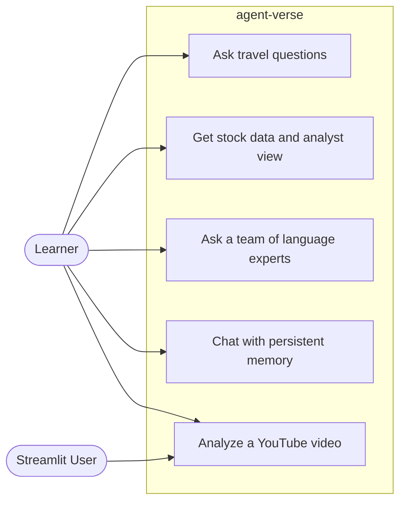

### UML 2 — Class Diagram

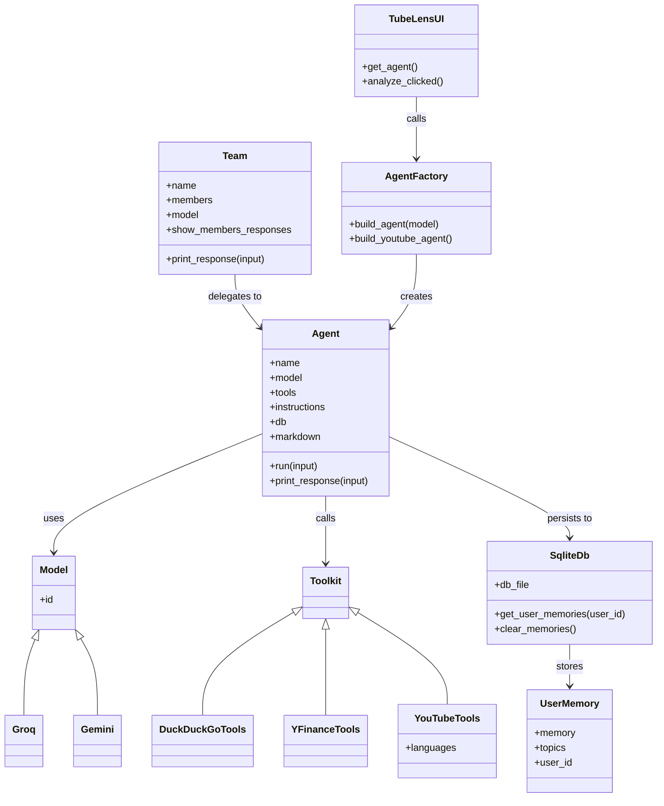

### UML 3 — Sequence Diagram (TubeLens analysis)

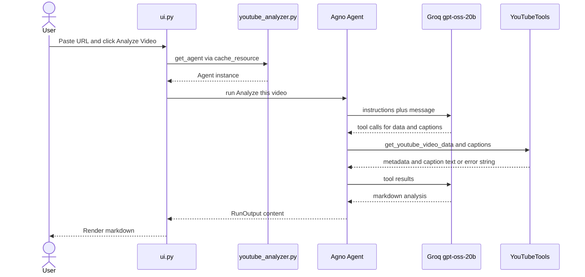

### UML 4 — Collaboration Diagram

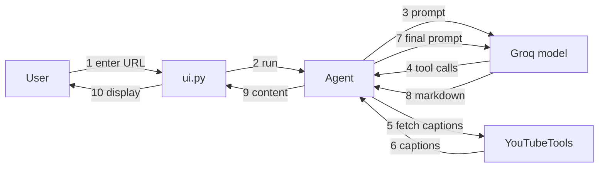

### UML 5 — Activity Diagram

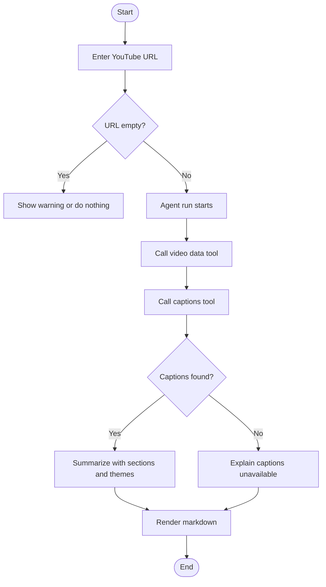

### UML 6 — State Diagram (Streamlit analysis lifecycle)

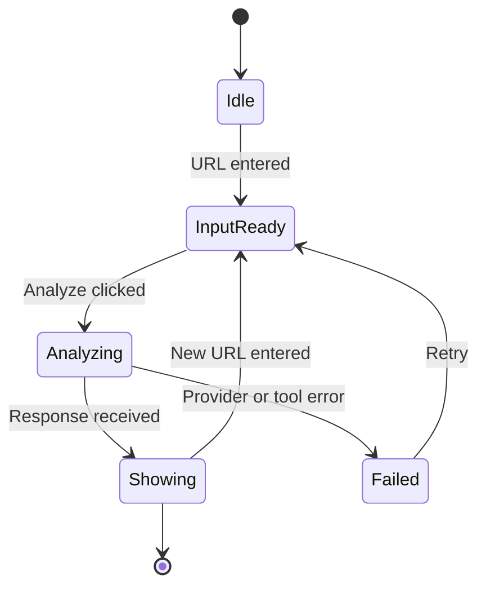

### UML 7 — Component Diagram

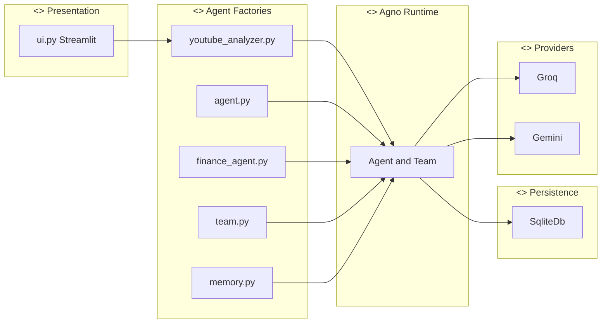

### UML 8 — Deployment Diagram (local development)

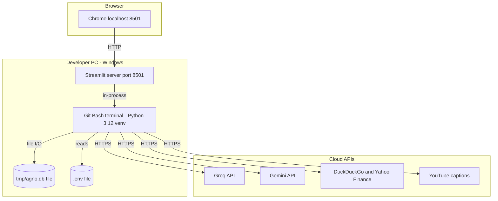

### UML 9 — Package Diagram

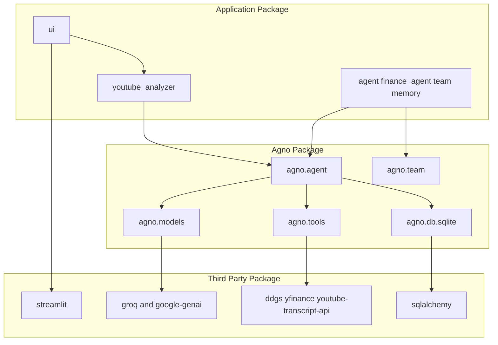

### Swimlane Diagram — Finance question across actors

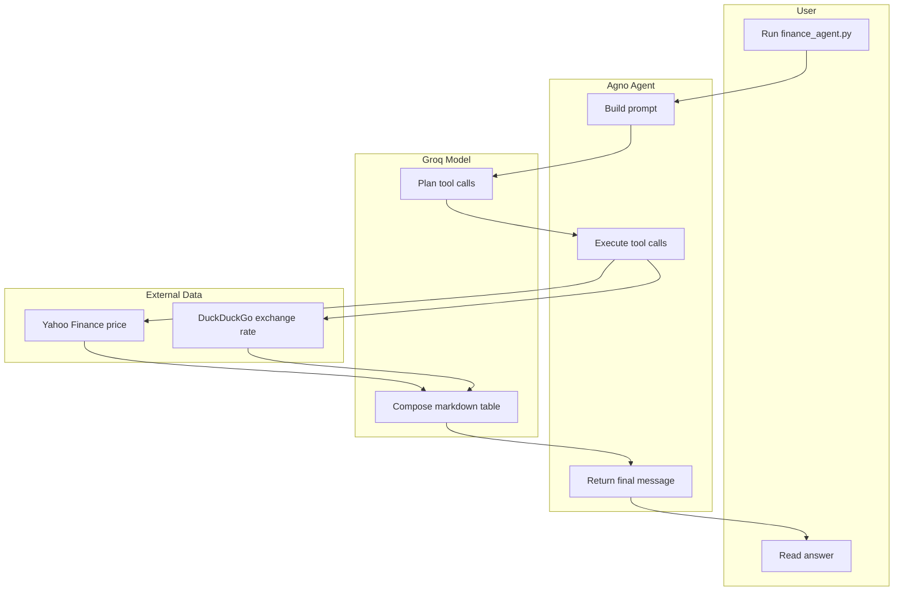

</details>

---

## Data Flow Diagrams

<details>
<summary>Data Flow Diagrams (Level 0 and Level 1)</summary>

### DFD Level 0 — Context Diagram

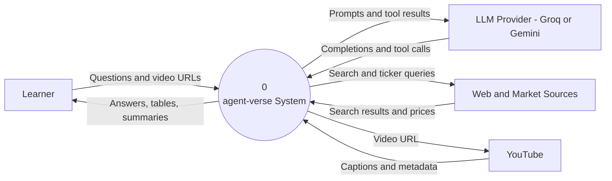

### DFD Level 1 — System

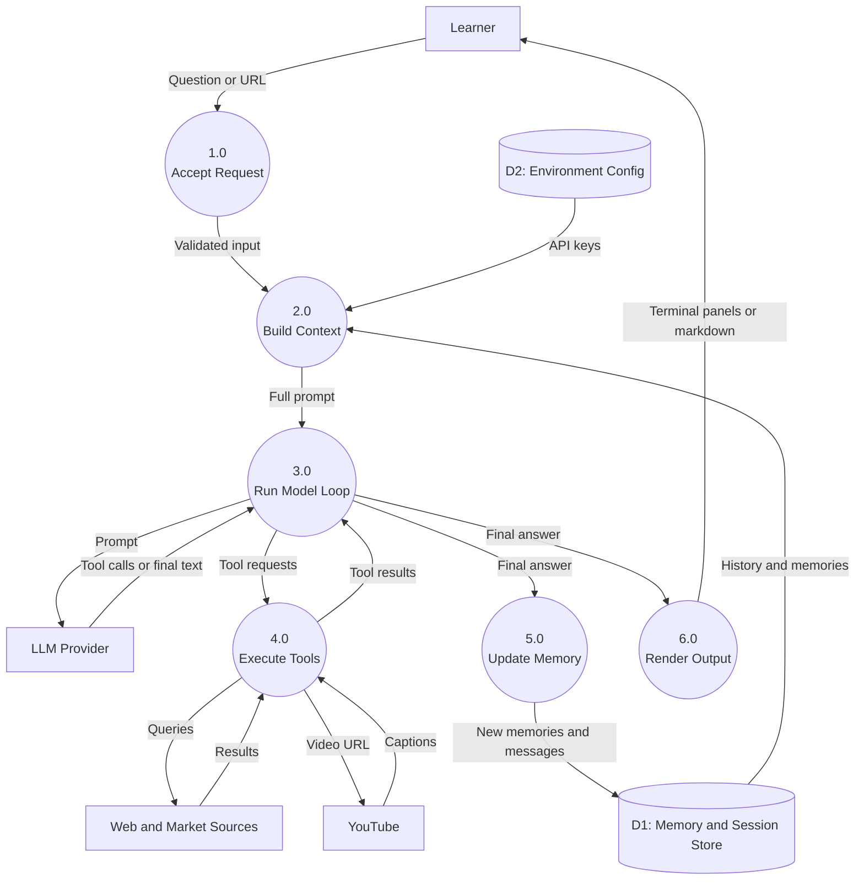

</details>

---

## Folder Structure

```
agent-verse/
├── agent.py               # Travel agent; build_agent(model) factory, Groq and Gemini instances
├── finance_agent.py       # Investment analyst agent: YFinanceTools + DuckDuckGoTools
├── team.py                # Team of English, Chinese and Hindi member agents
├── memory.py              # Agent with SqliteDb memory and history; prints stored UserMemory rows
├── youtube_analyzer.py    # build_youtube_agent(): YouTubeTools with caption language fallbacks
├── ui.py                  # TubeLens Streamlit app
├── requirements.txt       # Pinned dependencies
├── .gitignore             # Ignores .env, .venv, tmp/, *.db, caches, IDE files
├── docs/
│   └── images/            # Real screenshots used in this README
├── tmp/                   # (ignored) agno.db created at runtime
├── .env                   # (ignored) GROQ_API_KEY and GOOGLE_API_KEY
└── README.md
```

---

## Getting Started

### Prerequisites

- Python **3.12**
- [uv](https://docs.astral.sh/uv/) (or plain `python -m venv` + `pip`)
- A free **Groq** API key — <https://console.groq.com/keys>
- A free **Gemini** API key — <https://aistudio.google.com/apikey>

### Installation

```bash
# 1. Clone
git clone https://github.com/KARTHIKAKRISHNA123/agent-verse.git
cd agent-verse

# 2. Create and activate a virtual environment (Git Bash on Windows)
uv venv --python 3.12
source .venv/Scripts/activate        # Linux or macOS: source .venv/bin/activate

# 3. Install dependencies
uv pip install -r requirements.txt

# 4. Add your keys (the file is git-ignored)
cp .env.example .env 2>/dev/null || touch .env
# then edit .env — see the table below
```

### Environment Variables

| Variable | Required | Used by | Description |
|---|---|---|---|
| `GROQ_API_KEY` | Yes | All Groq agents (`agent.py`, `finance_agent.py`, `team.py`, `memory.py`, `youtube_analyzer.py`) | Groq Cloud API key |
| `GOOGLE_API_KEY` | Only for Gemini agents | `gemini_agent` in `agent.py` and `finance_agent.py` | Google AI Studio key |

### Run

```bash
python agent.py              # travel agent (Groq)
python finance_agent.py      # MSFT price in INR + analyst recommendations
python team.py               # one question, three language experts
python memory.py             # memory demo; creates tmp/agno.db
python youtube_analyzer.py   # CLI video summary (edit the URL at the bottom of the file)
streamlit run ui.py          # TubeLens at http://localhost:8501
```

---

## Configuration

| Setting | Where | Notes |
|---|---|---|
| Groq model | `Groq(id="openai/gpt-oss-20b")` | Free-tier model. `llama-3.3-70b-versatile` returned 404 on a free account |
| Gemini model | `Gemini(id="gemini-3.8-flash")` | `gemini-2.0-flash` has been retired |
| Caption languages | `YouTubeTools(languages=["en", "en-US", "en-GB"])` | Codes are exact and case-sensitive |
| Memory file | `SqliteDb(db_file="tmp/agno.db")` | Delete the file to reset memory |
| Debug traces | `debug_mode=True` in `finance_agent.py` | Prints every tool call and token metrics |

---

## Security Considerations

- API keys live only in `.env`, which is listed in `.gitignore` — never commit it.
- The app has **no authentication**; Streamlit is meant for local use. Do not expose port 8501 publicly without adding auth.
- Tool outputs (web pages, captions) are untrusted text fed to an LLM; prompt injection from a video transcript is possible in principle.
- Finance output is informational only and not investment advice.

## Error Handling, Logging and Testing

| Area | Current state |
|---|---|
| Error handling | Provider errors (404, 503, 429) surface as Agno `ERROR` logs and tracebacks; caption failures come back as tool error strings |
| Logging | Agno's built-in logger; `debug_mode=True` on the finance agent for full traces |
| Testing | No automated tests yet — verification has been manual runs (see screenshots) |

## Engineering Decisions and Tradeoffs

| Decision | Reason | Tradeoff |
|---|---|---|
| Two agents (Groq and Gemini) via `build_agent(model)` | Agno's `Agent` accepts one `model=` only | Slight duplication; easy provider comparison |
| `openai/gpt-oss-20b` on Groq | Works on the free tier with tool calling | Smaller model: more hallucination risk than larger paid models |
| `@st.cache_resource` for the agent | Avoids rebuilding the agent on every Streamlit rerun | Shared instance across sessions in one server process |
| SQLite for memory | Zero setup, single file | Not suitable for concurrent multi-user deployment |
| Language fallbacks `en`, `en-US`, `en-GB` | Different videos publish different English codes | Videos with only non-English or no captions still fail |

## Known Limitations

- **Possible fabrication when search fails.** If DuckDuckGo returns "No results found", the model may produce plausible but invented analyst data. Prefer `YFinanceTools` analyst data and instruct the agent never to invent figures.
- **Import-time side effects.** `agent.py`, `finance_agent.py` and `youtube_analyzer.py` run example calls at module level; importing them (as `ui.py` does) should be guarded with `if __name__ == "__main__":` and debug prints removed.
- **`session_id` is defined but not passed** in `memory.py`, so chat history is not tied to a fixed session across runs (user memories still persist).
- **Gemini agents are instantiated but not exercised** in every script.
- **Free-tier rate limits and model churn.** Model IDs get retired and Gemini can return `503 UNAVAILABLE` under load.
- No automated tests yet.

---

## Troubleshooting Guide

| Symptom (real error from development) | Cause | Fix |
|---|---|---|
| `Groq ... 404 model_not_found` for `llama-3.3-70b-versatile` | Model not available on a free Groq account | Use `openai/gpt-oss-20b` |
| `Gemini 404` for `gemini-2.0-flash` | Model retired | Use `gemini-3.8-flash` |
| `GOOGLE_API_KEY` not set | Key missing in `.env` | Add it and restart the shell |
| `ModuleNotFoundError: dotenv` | Wrong virtual environment active | Activate the project's `.venv` and reinstall requirements |
| `ImportError: greenlet` when using `SqliteDb` | Missing runtime dependency | `uv pip install greenlet` |
| `TypeError: unexpected keyword enable_user_memories` | Flag renamed in Agno 3.x | Use `update_memory_on_run=True` |
| `AttributeError: get_memories` | Method renamed | Use `db.get_user_memories(user_id=...)` |
| `Groq.__init__() got an unexpected keyword argument 'id'` | Imported the raw `groq.Groq` client | `from agno.models.groq import Groq` |
| `build_agent() missing 1 required positional argument: 'model'` | Factory signature requires a model | Call `build_agent(Groq(...))` |
| Captions unavailable for a video that has captions | Default `en` does not match the video's `en-US` code | Pass `languages=["en", "en-US", "en-GB"]` (see below) |
| Gemini `503 UNAVAILABLE` | Temporary provider load | Retry later or switch to the Groq agent |

**Caption language codes and an honest failure:**

| Available codes listed by `youtube-transcript-api` | "Captions unavailable" result in TubeLens |
|---|---|
| 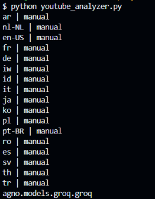 | 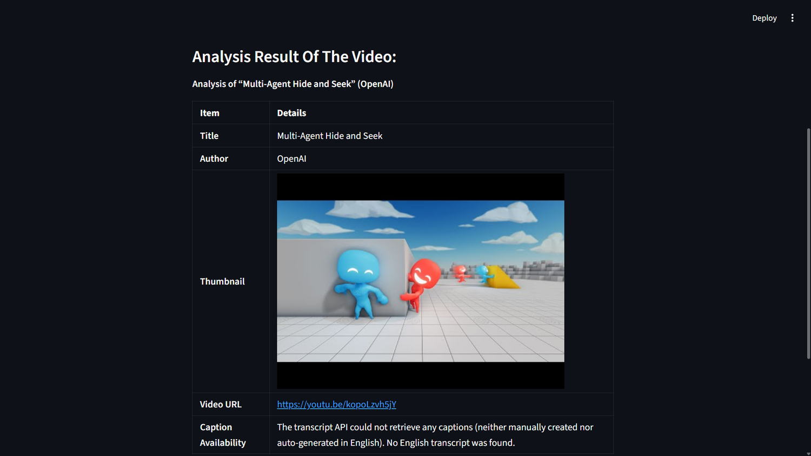 |

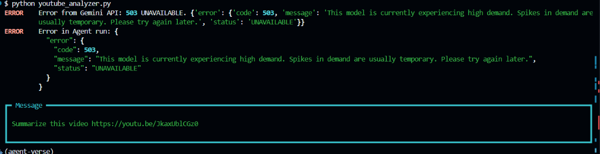

---

## FAQ

**Why Groq and Gemini instead of OpenAI?** Both have free tiers, which makes the whole project runnable without a paid account.

**Can I use only one provider?** Yes — only `GROQ_API_KEY` is required for the main flows.

**Does memory work across runs?** User memories do (stored in `tmp/agno.db`). Conversation history across runs needs a fixed `session_id`.

**Where do the screenshots come from?** They are captures of my own runs; nothing in `docs/images/` is from the tutorial video.